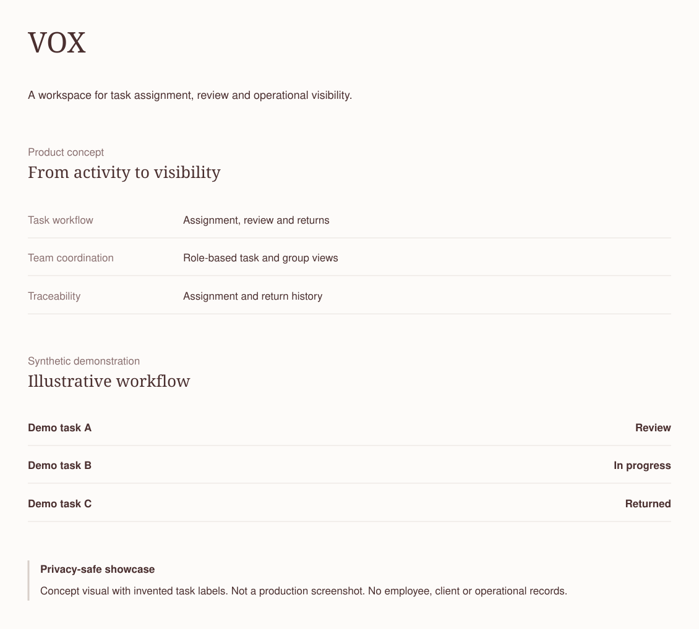
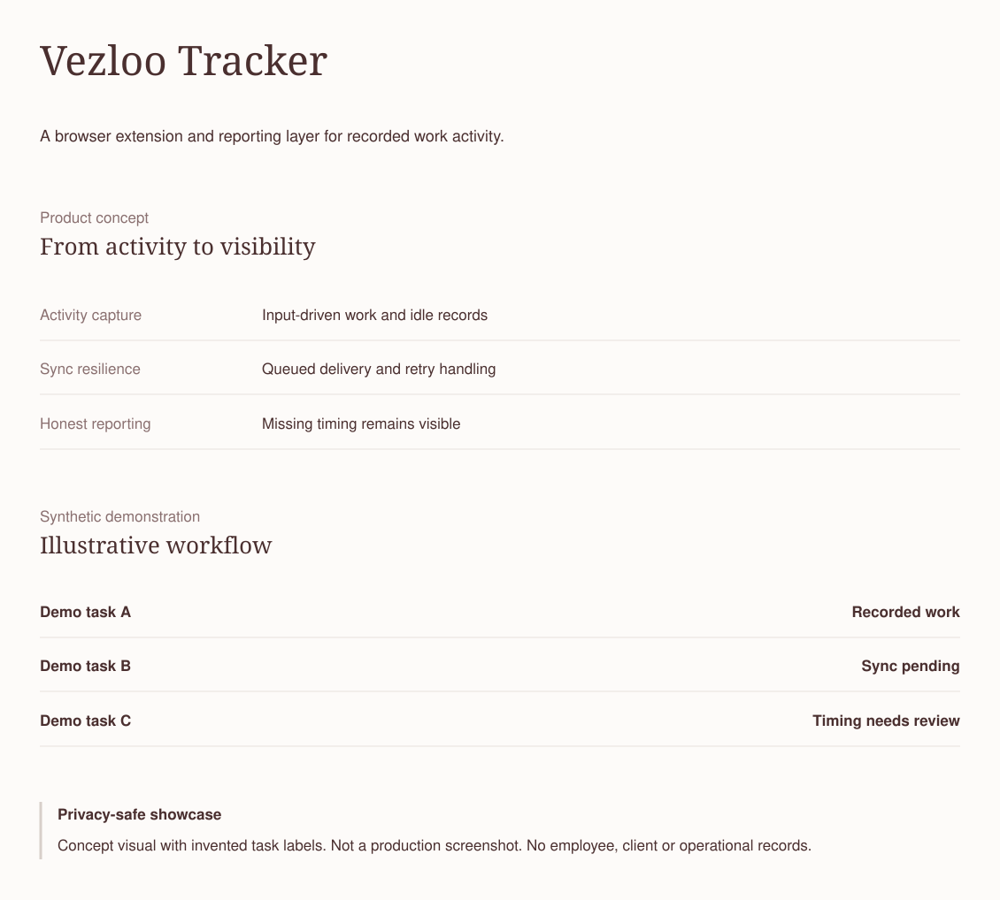

# Case studies

Two internal tools I designed and built with AI-assisted development. The source is private because it is tied to real operations. This repository holds only the narrative and illustrative visuals. There is no production code, configuration, data or screenshots here.

The images below are concept cards with invented "Demo task" labels. They are not screenshots of the deployed systems.

## VOX

An operations workspace for assigning tasks, coordinating review and following work through returns and reporting.

What is implemented:

- Role-based workspaces for administrators, reviewers and agents.
- Task assignment and review workflows, including return handling.
- Review-group membership and task visibility controls.
- Task tables, activity views and operations reports.
- Assignment history and audit records for changes.
- Server-side authorization and database access controls.

Stack: Next.js, React, TypeScript, PostgreSQL, Supabase.

Status and limits: the workflows are implemented and deployed to a restricted group. A company-wide rollout is not complete. I make no claim about payroll correctness, independent security audits or capacity at large user counts.

## Vezloo Tracker

A browser extension with a reporting backend for recorded work activity, task context and operational visibility.

What is implemented:

- Chrome Manifest V3 extension with a background service worker.
- Authenticated, task-linked session recording, with separate work and idle records.
- Input-driven meeting activity tracked separately from task work.
- Queued delivery and retry handling when the reporting backend is unavailable.
- Task access checks, and administrator review of unresolved identity cases.
- Recorded activity, task and output views with daily and monthly filters.
- Explicit warnings when historical timing is incomplete, instead of guessed totals.

Stack: JavaScript, Chrome Extensions (Manifest V3), Python, FastAPI, SQLAlchemy, PostgreSQL, HTML/CSS.

Status and limits: queued reporting does not guarantee that a third-party platform saves work during an outage. Recorded activity is not a measure of effort or a certification of payable hours. Missing history is flagged, not reconstructed. Clock and meeting-interval features that are still experimental are not part of what I describe here.

## About

Ahmed Khaled, Cairo. Profile: https://github.com/KEPV18
